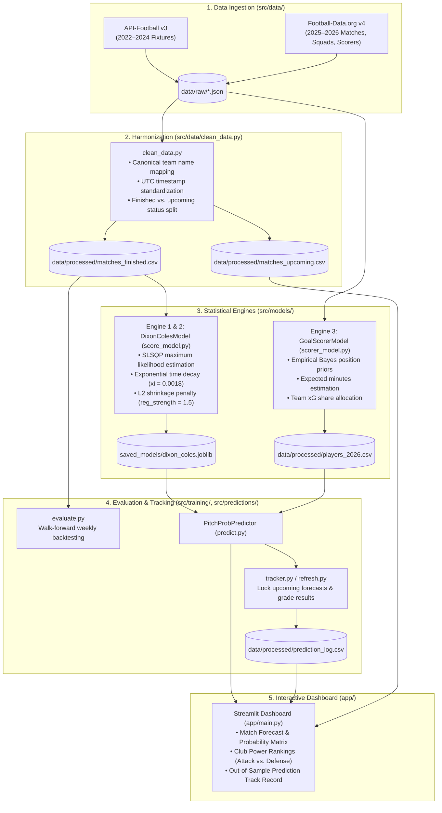

# Pitch-prob

Pitch-prob is a Premier League match forecasting and goalscorer probability system. It models match outcomes and exact scorelines using an L2-regularized, time-decayed Dixon-Coles bivariate Poisson formulation, and projects anytime goalscorer probabilities through empirical Bayes player position priors and team expected goal ($xG$) allocation.

---

## System Architecture



---

## Methodology & Models

### 1. Match Outcome & Scoreline Engine (`src/models/score_model.py`)

The match engine implements the Dixon and Coles (1997) bivariate Poisson formulation with two enhancements: exponential time decay and L2 parameter regularization.

#### Goal Expectancy
For home team $i$ and away team $j$, goal expectancies $\lambda$ (home) and $\mu$ (away) are modeled as:

$$\lambda = \exp(\alpha_i + \beta_j + \gamma)$$

$$\mu = \exp(\alpha_j + \beta_i)$$

where:
* $\alpha_i$: Attack strength of team $i$.
* $\beta_j$: Defensive vulnerability of team $j$ (higher values indicate more goals conceded).
* $\gamma$: Home field advantage parameter.

#### Exponential Time Decay
Historical matches are downweighted as a function of elapsed time $\Delta t_k$ (in days) relative to the evaluation date:

$$w_k = \exp(-\xi \cdot \Delta t_k)$$

The decay parameter $\xi = 0.0018\text{ day}^{-1}$ yields an observation half-life:

$$t_{1/2} = \frac{\ln(2)}{0.0018} \approx 385\text{ days}$$

This weights the past full season at 50% relative to current matches.

#### Low-Score Dependency ($\tau$)
Independent Poisson distributions underestimate low-scoring scorelines ($0\text{--}0, 1\text{--}1$) and overestimate single-goal scorelines ($1\text{--}0, 0\text{--}1$). The Dixon-Coles adjustment parameter $\rho$ corrects the probability matrix:

$$\tau(x, y, \lambda, \mu, \rho) = \begin{cases}
1 - \lambda \mu \rho & \text{if } x = 0, y = 0 \\
1 + \lambda \rho & \text{if } x = 0, y = 1 \\
1 + \mu \rho & \text{if } x = 1, y = 0 \\
1 - \rho & \text{if } x = 1, y = 1 \\
1.0 & \text{otherwise}
\end{cases}$$

#### Regularized Objective Function
Parameters are estimated by minimizing the weighted negative log-likelihood with an L2 shrinkage penalty on team parameters:

$$\mathcal{L} = -\sum_{k=1}^N w_k \left[ \ln \tau(x_k, y_k, \lambda_k, \mu_k, \rho) + \ln \text{Poisson}(x_k; \lambda_k) + \ln \text{Poisson}(y_k; \mu_k) \right] + \lambda_{\text{reg}} \sum_{i=1}^M (\alpha_i^2 + \beta_i^2)$$

* **Identifiability Constraint:** $\frac{1}{M} \sum_{i=1}^M \alpha_i = 0$ enforced via equality constraint in SLSQP.
* **L2 Regularization ($\lambda_{\text{reg}} = 1.5$):** Prevents promoted clubs with small sample sizes from producing unstable attack or defense estimates.

#### Derived Market Probabilities
Evaluating over scoreline grid $x, y \in \{0, \dots, 8\}$ yields matrix $M_{x,y} = P(X=x, Y=y)$:

$$P(\text{Home Win}) = \sum_{x > y} M_{x,y}, \quad P(\text{Draw}) = \sum_{x = y} M_{x,y}, \quad P(\text{Away Win}) = \sum_{x < y} M_{x,y}$$

$$P(\text{Over 2.5 Goals}) = \sum_{x + y > 2} M_{x,y}, \quad P(\text{BTTS}) = \sum_{x \ge 1, y \ge 1} M_{x,y}$$

---

### 2. Anytime Goalscorer Engine (`src/models/scorer_model.py`)

1. **Empirical Bayes Position Priors:** Baseline goals-per-90 rates are assigned by positional role:
   * Centre-Forward: $0.42$ | Left/Right Winger: $0.30$ | Attacking Midfield: $0.24$
   * Central Midfield: $0.12$ | Defensive Midfield: $0.07$ | Full-Back: $0.06$ | Centre-Back: $0.05$ | Goalkeeper: $0.001$

2. **Bayesian Shrinkage:** Observed goals $g_p$ over appearances $m_p$ are smoothed toward position prior $r_{\text{pos}}$ using pseudo-count weight $M_0 = 6.0$:

   $$\lambda_{\text{base}, p} = \frac{g_p + M_0 \cdot r_{\text{pos}}}{m_p + M_0}$$

3. **Starting Probability & Lineup Overrides:**
   * Default starting probability is estimated from appearances relative to team match count:
     $$P(\text{Start}) = \min\left(0.95, \max\left(0.35, \frac{\text{appearances}}{\text{team matches}}\right)\right)$$
   * When confirmed team news is supplied, selected starters are set to $P(\text{Start}) = 0.95$, bench squad members are discounted to $0.25 \times P(\text{Start})$, and ruled-out players are removed.

4. **Team $xG$ Allocation & Anytime Probability:**
   * Individual weight: $w_p = \lambda_{\text{base}, p} \cdot P(\text{Start}_p)$
   * Allocated player $xG$:
     $$xG_p = xG_{\text{team}} \cdot \frac{w_p}{\sum_{q \in \text{squad}} w_q}$$
   * Anytime goalscorer probability (Poisson zero-truncation):
     $$P(\text{Goals}_p \ge 1) = 1 - \exp(-xG_p)$$

---

### 3. Validation & Backtesting (`src/training/evaluate.py`)

Model performance is evaluated using an expanding walk-forward backtest. Matches are partitioned into 7-day matchweek bins across the 2025 and 2026 seasons. For each matchweek, parameters are estimated exclusively on matches completed prior to that week's earliest kickoff date ($t < t_{\text{cutoff}}$) with a 380-match minimum training burn-in.

#### Out-of-Sample Results (480 Matches Tested, 2025–2026 Seasons)

| Decay Rate $\xi$ | Observation Half-Life | Out-of-Sample Accuracy | Multi-Class Log Loss | Multi-Class Brier Score | Goals MAE |
| :--- | :--- | :---: | :---: | :---: | :---: |
| $\xi = 0.0005$ | ~1,386 days (~3.6 seasons) | 47.3% | 1.0426 | 0.6191 | 0.909 |
| **$\xi = 0.0018$ (Selected)** | **~385 days (~1.0 season)** | **48.8%** | **1.0410** | **0.6170** | **0.908** |
| $\xi = 0.0035$ | ~198 days (~0.5 season) | 46.7% | 1.0447 | 0.6188 | 0.912 |

$\xi = 0.0018$ achieves the lowest Log Loss and Brier Score, indicating optimal probability calibration for 1X2 market distribution.

---

## Project Structure

```
pitch-prob/
├── requirements.txt                   # Production Python package dependencies
├── .env                               # Local API credentials (git-ignored)
├── .gitignore                         # Build, venv, and data artifact exclusions
├── app/
│   ├── main.py                        # Streamlit dashboard (Forecast, Rankings, Track Record)
│   ├── components/                    # UI component modular extensions (placeholder)
│   └── pages/                         # Multi-page dashboard extensions (placeholder)
├── data/
│   ├── raw/                           # Raw API JSON responses (git-ignored)
│   │   ├── pl_fixtures_apifb_*.json   # API-Football fixture tables (2022–2024)
│   │   ├── pl_matches_fd_*.json       # Football-Data.org match tables (2025–2026)
│   │   ├── pl_teams_squads_2026.json  # 2026/27 club rosters and crest URLs
│   │   └── pl_scorers_2026.json       # 2026/27 season top goalscorer stats
│   ├── processed/                     # Harmonized CSV data files (git-ignored)
│   │   ├── matches_finished.csv       # 1,620 completed matches with outcomes (2022–2026)
│   │   ├── matches_upcoming.csv       # 280 scheduled fixtures for the current season
│   │   ├── players_2026.csv           # 546 active players with position priors and goal rates
│   │   └── prediction_log.csv         # Locked pre-match forecasts and graded results
│   └── features/                      # Intermediate feature stores (placeholder)
├── saved_models/
│   └── dixon_coles.joblib             # Serialized Dixon-Coles parameters (attack, defense, rho)
└── src/
    ├── data/
    │   ├── fetch_data.py              # Ingests historical and current match JSON from APIs
    │   ├── fetch_players.py           # Ingests team squads, rosters, and top scorers
    │   ├── clean_data.py              # Standardizes team names, converts UTC dates, splits sets
    │   └── refresh.py                 # Automated pipeline for matchweek updates and retraining
    ├── models/
    │   ├── score_model.py             # Regularized Dixon-Coles bivariate Poisson model
    │   └── scorer_model.py            # Empirical Bayes goalscorer allocation model
    ├── predictions/
    │   ├── predict.py                 # Unified interface generating match & scorer forecasts
    │   └── tracker.py                 # Pre-match prediction locking and grading engine
    └── training/
        └── evaluate.py                # Walk-forward backtesting and calibration harness
```

---

## Setup & Local Execution

### 1. Environment Configuration

Clone the repository and create an isolated virtual environment:

```bash
git clone https://github.com/azmil666/pitch-prob.git
cd pitch-prob

python3 -m venv venv
source venv/bin/activate
pip install -r requirements.txt
```

### 2. API Keys

Create a `.env` file in the root directory with tokens for both data providers:

```env
FOOTBALL_DATA_ORG_KEY="your_football_data_org_api_token"
API_FOOTBALL_KEY="your_api_football_api_token"
```

* `FOOTBALL_DATA_ORG_KEY`: Required for current season fixtures, rosters, and live matchweek refreshes ([football-data.org](https://www.football-data.org/)).
* `API_FOOTBALL_KEY`: Used for historical 2022–2024 backfill ingestion ([api-football.com](https://www.api-football.com/)).

### 3. Launch Dashboard

Run the Streamlit application:

```bash
streamlit run app/main.py
```

The dashboard will open at `http://localhost:8501` featuring:
1. **Match Forecast:** Outcome probabilities (1X2), total goals expectation, exact scoreline heatmap, and anytime goalscorer projections with confirmed lineup adjustments.
2. **Club Power Rankings:** Latent attack vs. defensive solidity quadrant chart with official club crests.
3. **Track Record:** Real-time ledger of pre-match locked predictions evaluated against full-time results.

---

## Matchweek Operations (Refresh & Prediction Grading)

To process a completed matchweek, execute the end-to-end update pipeline:

```bash
python3 src/data/refresh.py
```

This single command executes a five-stage operational workflow:

1. **API Ingestion:** Pulls the latest match results and updated goalscorer leaderboards from `football-data.org` while adhering to the 10 request/min rate limit.
2. **Data Harmonization:** Rebuilds `matches_finished.csv` and `matches_upcoming.csv` with standardized team keys.
3. **Model Retraining:** Re-fits the regularized Dixon-Coles model on all historical completed matches and writes the updated parameter state to `saved_models/dixon_coles.joblib`.
4. **Player Base Rate Updates:** Recalculates empirical Bayes shrinkage rates across all 546 active squad members in `players_2026.csv`.
5. **Prediction Tracking & Grading:**
   * Compares `PENDING` forecasts in `prediction_log.csv` against newly recorded full-time scores, logging 1X2 hit rates, exact score hits, and multi-class log loss.
   * Identifies upcoming fixtures within the next 14 days and locks their pre-match forecasts into `prediction_log.csv` before kickoff.

The refresh operation can also be triggered directly from the Streamlit UI via the sidebar **Refresh Matchweek Data** control.

